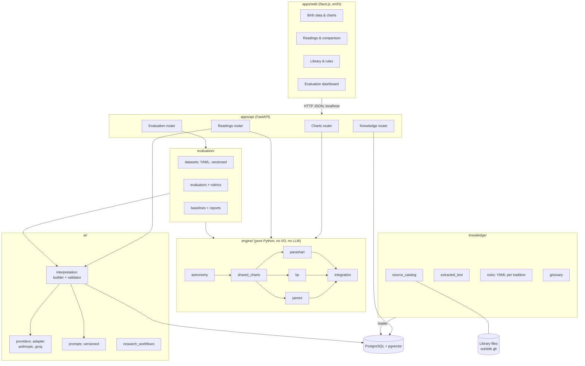
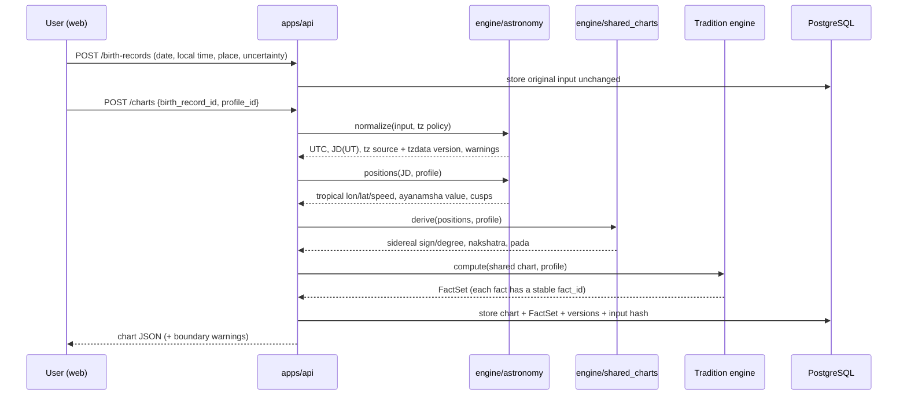

# Technical Design — Jyotish Research Platform

> Status: DRAFT v0.3 (2026-11-17, post-review corrections: model naming, provenance, testing timing; see [decisions.md](decisions.md) changelog). Source plan: [../integrated_jyotish_project_plan.md](../integrated_jyotish_project_plan.md).
> Decisions referenced as `D-NNN` live in [decisions.md](decisions.md). Anything marked **PROPOSED** is a default awaiting owner confirmation.

## 1. Context and constraints

- **Release 1 target:** single user (the project owner), running locally on their own machine via Docker Compose (D-001). No public hosting, no multi-user accounts.
- **Languages:** English and Hindi UI and readings; Sanskrit terms shown in IAST and Devanagari (D-002).
- **Three traditions, kept distinct:** Parashari, KP, Jaimini. Each has its own calculation profile, engine, rule set, prompts, and tests.
- **Calculation is deterministic code. Interpretation is the only thing an LLM does**, and it works from structured facts and approved source material.
- **Everything reproducible:** every chart, reading, and evaluation run records the software, ephemeris, profile, dataset, model, and prompt versions that produced it.

## 2. Tech stack

| Area | Choice | Status |
|---|---|---|
| Backend language | Python 3.12 (upgrade once `pyswisseph` and other deps support newer) | PROPOSED (D-019) |
| API framework | FastAPI + Pydantic v2 | ACCEPTED (plan §13) |
| Frontend | Next.js (App Router) + TypeScript (strict) | ACCEPTED (plan §13) |
| i18n | `next-intl` for UI strings (en, hi) | PROPOSED (D-002) |
| Database | PostgreSQL 17 + `pgvector` extension | PROPOSED (D-017) |
| Migrations | Alembic | PROPOSED |
| DB access | SQLAlchemy 2.x | PROPOSED |
| Ephemeris | Swiss Ephemeris via `pyswisseph` (AGPL, acceptable for personal local use) | PROPOSED (D-013) |
| Independent astro reference | Skyfield + JPL DE440/DE441 (tests only) | PROPOSED (D-013) |
| Time zones | IANA tzdata via Python `zoneinfo`, with manual override | PROPOSED (D-016) |
| Geocoding | Offline GeoNames `cities500` dataset (no network lookup of birthplaces) | PROPOSED (D-015) |
| OCR | Tesseract (`eng`, `hin`, `san` models) locally, human review required | PROPOSED (D-020) |
| Full-text search | PostgreSQL FTS (`simple` config for Devanagari/IAST, `english` for English) | PROPOSED (D-017) |
| Semantic search | Local multilingual embedding model → `pgvector` | PROPOSED (D-017) |
| LLM runtime | Provider adapter with **Groq (Qwen) as the only runtime provider**; no Anthropic model is used by the product (D-030). Exact model IDs are configuration, verified before use (§6.1) | ACCEPTED (D-030, supersedes plan §8 Anthropic stage) |
| Tests | pytest, Hypothesis (property-based), Vitest, Playwright | PROPOSED |
| Lint/type | ruff, mypy (strict on `engine/`), ESLint, `tsc --noEmit` | PROPOSED |
| Module boundaries | `import-linter` contracts | PROPOSED (D-021) |
| Packaging/run | Docker + Docker Compose | ACCEPTED (plan §13) |

## 3. Component view



### 3.1 Components and responsibilities

| Component | Path | Responsibility | Must not |
|---|---|---|---|
| Astronomy | `engine/astronomy/` | Time normalization (local → UTC → JD UT), ephemeris calls, tropical positions, ayanamsha value, nodes, house cusps | Know about any tradition's rules |
| Shared charts | `engine/shared_charts/` | Sidereal positions, sign/degree, nakshatra/pada, common derived points, varga *mechanics* (sign division arithmetic) | Interpret anything |
| Parashari engine | `engine/parashari/` | Graha drishti, lordships, dignity, yogas, Shadbala, varga charts, Vimshottari | Import `kp` or `jaimini` |
| KP engine | `engine/kp/` | Star/sub/sub-sub lords, Placidus cusps & cuspal sub-lords, significators, ruling planets | Import `parashari` or `jaimini`; reuse Parashari house-lord logic |
| Jaimini engine | `engine/jaimini/` | Chara Karakas, Rashi Drishti, Argala/Virodhargala, Jaimini dashas | Import `parashari` or `kp`; reuse graha drishti |
| Integration | `engine/integration/` | Collect per-tradition `FactSet`s; compute agreement/disagreement/silence on a topic | Create new astrological rules |
| Provider adapter | `ai/providers/` | One interface (`generate(request) -> response`) with a Groq implementation and a fake provider for tests (further providers can be added behind the interface; none is planned, D-030); records model ID, params, tokens, latency | Hard-code model IDs (they come from config) |
| Prompts | `ai/prompts/` | Versioned prompt templates per mode and language, with a content hash | Be edited without bumping version |
| Interpretation | `ai/interpretation/` | Build reading requests from facts + retrieved rules/passages; validate structured output; render | Accept output that cites unknown facts/rules/passages |
| Research workflows | `ai/research_workflows/` | Claude Code–assisted rule extraction and case drafting procedures | Write directly to VERIFIED status |
| Knowledge | `knowledge/` (data) and `knowledge/rulebase/` (Python: schema, validator, lifecycle, approval, history check, runtime retrieval gate; [rule-schema.md](rule-schema.md)) | Source catalogue, extracted text, rule records (YAML in git), glossary | Hold copyrighted scans in git; import the engine, `ai/`, `evaluation/`, the API or the CLI |
| CLI | `jyotish_cli/` | The `jyotish` command (`rules validate/list/hash/seal/approve` today) | Contain business logic beyond calling `knowledge/` and `evaluation/` |
| Evaluation | `evaluation/` | Golden datasets, evaluators, rubrics, baselines, reports | Modify a frozen dataset version |
| API | `apps/api/` | HTTP surface, persistence, orchestration | Contain calculation logic |
| Web | `apps/web/` | UI in en/hi | Compute astrology client-side |

### 3.2 Dependency rules (enforced by `import-linter`, D-021)

```
apps/api  ──►  engine, ai, knowledge(loader), evaluation(runner)
ai        ──►  engine (types only), knowledge
evaluation──►  engine, ai
engine/integration ──► engine/{parashari,kp,jaimini}
engine/{parashari,kp,jaimini} ──► engine/shared_charts ──► engine/astronomy
FORBIDDEN: parashari ⟷ kp ⟷ jaimini (no cross-imports)
FORBIDDEN: engine/* ──► ai, apps, database, network
```

`engine/` is a pure library: inputs in, frozen dataclasses/Pydantic models out. That makes it independently testable and lets the evaluation framework call it without the API.

## 4. Calculation profiles

Every tradition reads its conventions from an explicit, versioned **CalculationProfile** (see [data-model.md](data-model.md)). Nothing defaults silently in code. Each profile has a stable content hash that is stored with every chart.

Initial profiles (every value **PROPOSED**, see D-003 to D-010 and D-025; open questions Q-001–Q-010 in [decisions.md](decisions.md)):

| Setting | `parashari-lahiri` | `kp-krishnamurti` | `jaimini-lahiri-7k` | `jaimini-lahiri-8k` |
|---|---|---|---|---|
| Zodiac | Sidereal | Sidereal | Sidereal | Sidereal |
| Ayanamsha | Lahiri / Chitrapaksha (`SE_SIDM_LAHIRI`, variant per Q-001) | KP-specific Krishnamurti (`SE_SIDM_KRISHNAMURTI`, variant per Q-002) | Lahiri | Lahiri |
| Node (`MEAN`/`TRUE`, required, D-004) | `MEAN` | `MEAN` | `MEAN` | `MEAN` |
| Houses | Whole sign; Bhava Chalit (Sripati) as optional view | **Placidus** cusps | Whole sign (rashi-based) | Whole sign (rashi-based) |
| Vimshottari year (`dasha_year_days`, D-025) | 365.25 | 365.25 (if Vimshottari used) | n/a | n/a |
| Vargas | Tranche 1: D1, D2, D3, D7, D9, D10, D12, D30 | n/a | D1, D9 (karakamsha) | D1, D9 (karakamsha) |
| Chara Karakas (`karaka_scheme`, D-007) | n/a | n/a | `SEVEN` (Sun–Saturn) | `EIGHT_WITH_RAHU` (Rahu 30° − deg) |
| Jaimini dasha (`jaimini_dasha_methods`, D-008) | n/a | n/a | `CHARA_KNRAO_<edition>` (under research: implementation and availability gates per D-008 rev. 3; `METHOD_NOT_AVAILABLE` until passed) | same |
| Sub-lord boundary | n/a | Start-inclusive, exact rational arithmetic (D-006) | n/a | n/a |

Profile rules:

- **Profiles are separate objects.** `parashari-lahiri` and the Jaimini Lahiri profiles share an ayanamsha value but not a profile, so a new version of one never changes another. KP has its own ayanamsha profile.
- **No engine contains a fallback default** for ayanamsha, node, house system, karaka scheme, dasha method, or year length. A missing setting is a validation error.
- **`karaka_scheme` and `jaimini_dasha_methods` are independent settings.** Selecting K.N. Rao Chara Dasha does not imply the 8-karaka scheme (D-007, Q-007).
- There is **no default Jaimini profile** (owner decision on Q-006, 2026-11-18): the user always chooses `jaimini-lahiri-7k` or `jaimini-lahiri-8k` explicitly.
- Each convention option that is offered has tests (e.g. node-dependent results under both `MEAN` and `TRUE`; dasha dates under each supported `dasha_year_days`).

## 5. Data flows

### 5.1 Chart calculation



Rules for this flow:

1. **Original input is never overwritten.** Normalized input is stored separately (plan §3).
2. Store tropical longitude **and** the ayanamsha value used, so sidereal values can be audited.
3. Charts are cached by `(input_hash, profile_hash, engine_version, ephemeris_version)`. Any change produces a new chart row, never an in-place update.
4. **Boundary warnings:** if a value lies within a configurable distance of a boundary that matters (sign, nakshatra, pada, KP sub, Placidus cusp, karaka tie), the engine returns a warning together with the birth-time shift that would change it.
5. **Birth-time uncertainty (D-010):** when the user gives ±N minutes, a sensitivity pass recomputes at window edges and reports which facts change.

### 5.2 Reading (interpretation)

```mermaid
sequenceDiagram
    participant U as User
    participant API as apps/api
    participant INT as ai/interpretation
    participant KN as knowledge (DB)
    participant AD as ai/providers
    participant LLM as Groq

    U->>API: POST /readings {chart_id, mode, language, question}
    API->>INT: build(FactSets for mode, question)
    INT->>KN: retrieve rules whose conditions match facts (by rule_id)<br/>+ passages (FTS + vector, filtered by tradition)
    KN-->>INT: rules, passages with citation_ids
    INT->>INT: minimise payload (D-027): categorical facts,<br/>rounded degrees, no identifiers
    INT->>AD: request(prompt vX, minimised facts, rules, passages, JSON schema)
    AD->>LLM: API call (treated as personal data)
    LLM-->>AD: structured JSON
    AD-->>INT: response + model id, params, tokens
    INT->>INT: validate: every claim has tradition + basis;<br/>fact_ids/rule_ids/citation_ids exist and match tradition
    alt validation fails
        INT->>AD: one repair attempt with validator errors
    end
    INT-->>API: Reading (validated, or flagged with failures)
    API->>KN: store reading + all versions
    API-->>U: rendered reading (en/hi) with attribution badges & citations
```

**Structured reading output (core contract):** each claim carries:

```json
{
  "claim_id": "c3",
  "text": "…",
  "tradition": "parashari | kp | jaimini | combined",
  "basis": "calculated_fact | source_rule | inference | uncertainty",
  "fact_ids": ["par.fact.lord.10.in.house.7"],
  "rule_ids": ["PAR-LRD-0042"],
  "citation_ids": ["SRC-BPHS-SANTHANAM-V1:ch24:v12"],
  "confidence": "high | medium | low",
  "agreement": "agree | disagree | silent | n/a"
}
```

The validator rejects claims that cite unknown IDs, attribute a KP rule to Parashari, or label inference as `source_rule`. This **mechanical guard against invented citations** is the main defence in plan §8 and §16.

**Mode rules:**

- Single-tradition modes pass **only** that tradition's FactSet, rules, and passages to the model.
- Comparative mode runs three single-tradition passes, then a comparison pass that may only reference claims already produced.
- Combined mode is the comparison pass plus synthesis, and every synthesized point must list the originating claim IDs. The individual readings stay attached to the combined reading.

**Language:** the model is asked to answer in the requested language (`en` or `hi`) from the same facts and sources. Sanskrit terms come from `knowledge/glossary` (IAST + Devanagari + English + Hindi gloss) so terminology stays consistent. Hindi output has its own suites: `reading-hi`, `comparison-hi`, `adversarial-hi` (D-029, [testing.md](testing.md) §6).

**Payload minimisation (D-027):** exact planetary positions can identify a person's birth moment, so every provider payload is treated as personal data. A dedicated `PayloadMinimiser` step (in `ai/interpretation/`) builds the payload from categorical facts, rounds any degree it must include (PROPOSED: whole degree), sends boundary proximity as a flag, includes only the dasha periods in the question's window (PROPOSED: month precision), and never includes names, places, coordinates, birth date/time, full-precision longitudes, cusps, ayanamsha values, or database IDs. Snapshot tests enforce this. Residual risk is documented in [security.md](security.md) §4.

### 5.3 Source ingestion

```
scan/PDF (outside git, unchanged) ──► checksum + catalogue entry (metadata, rights)
   ──► text extraction (embedded text, or Tesseract OCR eng/hin/san)
   ──► extracted_text/ with page mapping + OCR confidence
   ──► human review status per page: UNREVIEWED → REVIEWED → CORRECTED
   ──► chunk by chapter/verse/page ──► FTS index + embeddings (pgvector)
```

Passages with `UNREVIEWED` OCR can be searched, but the UI flags them and they cannot be cited as `VERIFIED` evidence (plan §9).

### 5.4 Rule extraction (research workflow)

```
Claude Code searches library ──► records passages + exact edition/locators
   ──► drafts rule YAML (status PROVISIONAL), reports ambiguities/conflicts
   ──► research/review model comments (DRAFT_REVIEW; exact model ID recorded)
   ──► owner source approval ──► VERIFIED | CONFLICTING_SOURCES | REJECTED
   ──► independent review/calculation recorded ONLY where one exists (independent_validation)
   ──► engine implementation references rule_id ──► unit + boundary tests (TECHNICAL_VALIDATION)
```

Rule YAML in `knowledge/rules/<tradition>/` is the source of truth, versioned in git and loaded into PostgreSQL for queries (D-018). VERIFIED means source-approved, not independently expert-validated. Roles are defined in [testing.md](testing.md) §7.

### 5.5 Evaluation run

Two separate tracks (D-022):

```
TRACK D: deterministic (no LLM; in CI: source-fidelity from M2, calculation-engine suites from M4)
  dataset version + suites (source-fidelity, astronomy, chart, parashari, kp, jaimini)
  ──► call engine directly ──► numeric tolerance / exact categorical / date / rule assertions
  ──► per-case results ──► report per suite, diff vs baseline

TRACK I: interpretation scoring (deliberate runs only)
  frozen dataset + suites (reading-en/hi, comparison-en/hi, adversarial-en/hi)
    + runtime config (provider, model ID, params, prompts) + judge config (provider, model ID, judge prompt, rubric)
  ──► run readings N times with the runtime model
  ──► tier 1: automatic checks (validator, IDs exist, attribution, prohibited claims, language/script)
              (also runs in CI with the fake provider from M6)
  ──► tier 2: evaluation judge model (owner proposal, Q-018: the same Groq model as the runtime, so runs are self-judged; never an Anthropic model, D-030) for rubric criteria automatic checks cannot decide
              (initial testing, model migrations, material prompt changes only)
  ──► tier 3: owner spot-checks (sampling rule: testing.md §6.4, Q-012; higher rate when self-judged)
  ──► record run metadata (data-model §6.3) + per-case, per-tier results; run then immutable
  ──► report per category and language, diff vs baseline, individual failures
```

Evaluation runs start only from the CLI or dashboard. They never run automatically on a user request (plan §11 Stage C). **No model is ever the sole authority** for accepting golden answers it drafted (this includes Claude Code as the drafting tool and the Qwen runtime): such cases need owner approval plus independent evidence (D-022, D-030).

The framework is built **progressively** (D-028): source-fidelity checks from M2, expanded rule/attribution checks in M3, calculation-engine suites from M4 and M5, Track I infrastructure in M6, first deliberate model evaluation in M7. See [testing.md](testing.md) §6.5 and [implementation-plan.md](implementation-plan.md).

## 6. Integrations

| Integration | Purpose | Notes |
|---|---|---|
| Swiss Ephemeris (`pyswisseph`) | Planetary positions, ayanamsha, houses | Ship `.se1` data files for 1800–2399 CE. Outside that range the API returns a clear error. AGPL: fine for local personal use; revisit before any distribution or SaaS (D-013). |
| Skyfield + JPL DE440/441 | Independent reference in tests | Not used at runtime. |
| IANA tzdata | Historical offsets & DST | Record tzdata version per chart. Pre-1955 Indian local times (e.g. Bombay/Calcutta time, 1942–45 war time) need manual override and explicit warnings (D-016). |
| GeoNames | Place → lat/lon/tz | Imported offline; no birthplace leaves the machine. |
| Groq API | Qwen runtime model (initial experimental runtime, accepted by the owner) and the judge (Q-018 owner proposal) | Model ID recorded and catalogue-checked 2026-11-18 (D-012); **Preview** status, risk in Q-019; ZDR UNCONFIRMED (security.md §4). Payloads minimised (D-027). |
| Anthropic API | **Not used** (D-030) | Claude Code is the coding tool, not an app integration. |
| Tesseract OCR | Text extraction | Local. Devanagari OCR quality is limited, so human review is mandatory. |

### 6.1 Model roles and model IDs

| Role | Configured by | Recorded on | Notes |
|---|---|---|---|
| **Runtime model** (generates readings) | `RUNTIME_PROVIDER`, `RUNTIME_MODEL_ID` | `reading`, `evaluation_run.runtime_*`, `case_result.runtime_model_id` | Groq Qwen (D-012, D-030) |
| **Evaluation judge model** (Track I tier 2) | `EVAL_JUDGE_PROVIDER`, `EVAL_JUDGE_MODEL_ID` | `evaluation_run.judge_*`, `case_result.judge_*` | Deliberate runs only |
| **Research/review model** (drafts or reviews rules and golden cases) | Not an app setting; used via Claude Code workflows | `rule_review`, `golden_case.drafted_by` / `reviewed_by` (provider + exact model ID) | Never the sole authority for its own drafts (D-022) |

- Model IDs are **configuration values only**. No code, prompt, or test hard-codes one.
- Before first use, each ID is checked against the provider's **official** model catalogue or API documentation. The verification date, source, and exact ID go into the register in [decisions.md](decisions.md). Groq: D-012 (recorded 2026-11-18). Judge model: owner proposal in Q-018 (same model as the runtime). Anthropic: not used (D-030).
- An unverified ID is left blank; it never gets a guessed value. The API refuses to activate an unverified model (`MODEL_NOT_VERIFIED`).
- When the runtime and judge are the same provider + model ID, the run is **self-judged** (D-022).

## 7. Cross-cutting concerns

- **Versioning and provenance:** `engine_version` (semver, bumped on any output-affecting change) and `profile_hash`, `ephemeris_version`, and `git_commit` are stored on each **chart**; `tzdata_version` on its `normalized_input`. A **reading** stores its own git commit, runtime provider, exact runtime model ID, parameters, prompt version IDs (with content hashes), retrieval IDs, and minimiser version/config. It **inherits** engine, profile, ephemeris, and tzdata versions from its immutable charts ([data-model.md](data-model.md) §5.2). An **evaluation run** stores runtime and judge configuration separately, plus dataset version + hash, rubric versions, git commit, engine version, profile refs, and the self-judged flag ([data-model.md](data-model.md) §6.3). Everything listed is returned by the API, so the UI shows only provenance that is actually stored.
- **Precision:** angles are handled internally as float64 degrees from the ephemeris. Boundary-sensitive comparisons (KP sub, nakshatra, pada) use exact arithmetic in integer milli-arcseconds or `fractions.Fraction` (D-006). Display rounding happens only in the UI layer.
- **Errors:** engines raise typed exceptions (`OutOfEphemerisRange`, `AmbiguousLocalTime`, `NonexistentLocalTime`, `HouseSystemUndefined`). The API maps them to problem+json (see [api.md](api.md)).
- **Observability:** structured JSON logs, with no birth data in logs. LLM calls log model, prompt version, tokens, latency, and cost estimate.
- **Security & privacy:** see [security.md](security.md). In summary: localhost-only, secrets in `.env`, minimal data sent to LLMs, books outside git.

## 8. Key architecture decisions (summary)

| ID | Decision | Status |
|---|---|---|
| D-001 | Local single-user release first; web/SaaS later | ACCEPTED |
| D-002 | English + Hindi UI and readings | ACCEPTED |
| D-003 | Separate `parashari-lahiri`, `jaimini-lahiri-*`, `kp-krishnamurti` profiles | PROPOSED |
| D-004 | Node `MEAN`/`TRUE` required per profile, both tested | PROPOSED |
| D-005 | Whole sign (Parashari, Jaimini); Placidus (KP) | PROPOSED |
| D-006–D-010 | KP precision, karaka profiles (7k/8k separate), K.N. Rao Chara Dasha from exact edition, vargas, time uncertainty | PROPOSED |
| D-011 | Book inventory & recommended references with copyright checks | OPEN |
| D-012 | Groq model ID verified before use, never hard-coded | OPEN (rule ACCEPTED) |
| D-013 | Swiss Ephemeris under AGPL for local use; Skyfield/JPL as independent reference | PROPOSED |
| D-017 | PostgreSQL FTS + pgvector for library search | PROPOSED |
| D-018 | Rules and golden cases as YAML in git; DB is a query index | PROPOSED |
| D-021 | Tradition isolation enforced with import-linter | PROPOSED |
| D-022 | Track D (deterministic) vs Track I (interpretation: automatic → judge model → owner); judge model = runtime model by owner proposal (Q-018), so runs are self-judged | ACCEPTED (judge part superseded by D-030) |
| D-023 | All reading types (single ×3, comparative, combined) built before the first full evaluation | ACCEPTED (wording superseded by D-030) |
| D-030 | No Anthropic model in the product; Groq Qwen is the only runtime provider | ACCEPTED |
| D-025 | Vimshottari year length configurable, 365.25 days initial | PROPOSED |
| D-026 | Pure, deterministic, tradition-isolated engines; provider adapter; no hard-coded model IDs | ACCEPTED (plan principles) |
| D-027 | Provider payloads treated as personal data and minimised | ACCEPTED (values PROPOSED) |
| D-028 | Evaluation framework built progressively from the research milestone | ACCEPTED |
| D-029 | Hindi reading, comparison, adversarial suites | ACCEPTED |

Full rationale and alternatives: [decisions.md](decisions.md).

## 9. Future evolution (not in release 1)

- Multi-user web deployment with authentication and roles (owner, reviewer, viewer). The API is designed to be stateless so an auth layer can be added in front of it.
- Swiss Ephemeris professional licence, or a switch to a permissively licensed ephemeris, before any distribution.
- Additional Jaimini dashas (Narayana and others), remaining Shodashavarga charts, transit (gochara) module, Prashna (KP horary using ruling planets).
