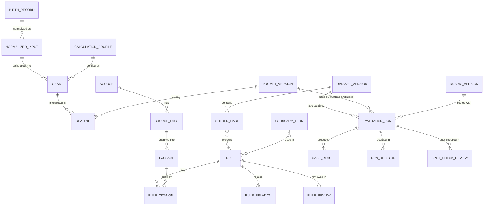

# Data Model — Jyotish Research Platform

> Status: DRAFT v0.3 (2026-11-17, post-review corrections: provenance, reviewer metadata, `dasha_year_days` scope). Storage: PostgreSQL 17 + pgvector (D-017). Rules and golden cases are YAML in git and loaded into the DB as an index (D-018).
> Related: [architecture.md](architecture.md), [api.md](api.md).

## 1. Conventions

- Primary keys: UUIDv7 (`id`) for DB-native entities. Human-readable stable IDs for knowledge objects (`rule_id`, `case_id`, `source_id`).
- Timestamps: `timestamptz`, stored in UTC.
- Angles: `double precision` degrees in [0, 360) for longitudes. Boundary logic in code uses exact arithmetic (D-006).
- Large computed outputs (FactSets, reading JSON) are stored as `jsonb` with a `schema_version`.
- **Immutability:** `birth_record` original fields, `calculation_profile` (once used), `chart`, `prompt_version`, `rubric_version`, `reading`, `dataset_version` (when frozen), `evaluation_run` and its `case_result` rows (once the run is COMPLETED, FAILED, or CANCELLED) are append-only. Corrections create new rows. Owner decisions and spot-check verdicts on a finished run are stored as separate append-only records (§6.5) so the run itself never changes.
- **Provenance by reference:** a record may *inherit* provenance from an immutable record it references instead of copying it (e.g. a reading inherits engine, profile, ephemeris, and tzdata versions from its charts). Each inherited field is listed explicitly where it applies (§5.2, §6.3).
- Enum values are UPPER_SNAKE in the DB and lowercase in JSON APIs.

## 2. Entity overview



## 3. Charts

### 3.1 `birth_record`: original input, never modified

| Field | Type | Rules |
|---|---|---|
| id | uuid | PK |
| label | text | required, 1–200 chars (e.g. "Self", "Test case A") |
| birth_date_local | date | required. Proleptic Gregorian; dates before 1582-10-15 rejected in R1 |
| birth_time_local | time | required (seconds optional) |
| time_uncertainty_min | int | ≥ 0, default 0 |
| time_source | enum | CERTIFICATE, HOSPITAL, FAMILY_RECALL, RECTIFIED, UNKNOWN |
| place_name | text | as entered |
| geonames_id | int | nullable |
| latitude | numeric(9,6) | −90..90 |
| longitude | numeric(9,6) | −180..180 |
| tz_name | text | IANA name, nullable if manual offset used |
| manual_utc_offset_min | int | nullable; −720..+840 |
| manual_dst | bool | nullable |
| override_reason | text | required if a manual field is set |
| notes | text | |
| created_at | timestamptz | |
| deleted_at | timestamptz | soft delete → hard delete job (US-1002) |

### 3.2 `normalized_input`

| Field | Type | Rules |
|---|---|---|
| id | uuid | PK |
| birth_record_id | uuid | FK |
| utc_datetime | timestamptz | |
| julian_day_ut | double | |
| delta_t_sec | double | as reported by ephemeris |
| utc_offset_min | int | applied offset |
| dst_applied | bool | |
| tz_resolution | enum | IANA, MANUAL, LMT |
| tzdata_version | text | e.g. `2026b` |
| ambiguity | enum | NONE, AMBIGUOUS_RESOLVED_EARLIER, AMBIGUOUS_RESOLVED_LATER, NONEXISTENT_SHIFTED |
| warnings | jsonb | list of codes |
| input_hash | char(64) | SHA-256 of canonical original input + resolution choices |

### 3.3 `calculation_profile`: versioned, immutable once used

| Field | Type | Rules |
|---|---|---|
| id | uuid | PK |
| key | text | e.g. `parashari-lahiri`, `kp-krishnamurti`, `jaimini-lahiri-7k`, `jaimini-lahiri-8k` (separate profiles, D-003) |
| version | int | increments on edit; (key, version) unique |
| tradition | enum | PARASHARI, KP, JAIMINI, SHARED |
| settings | jsonb | validated against profile JSON Schema (below) |
| profile_hash | char(64) | SHA-256 of canonical `settings` |
| status | enum | PROPOSED, ACTIVE, RETIRED |
| decision_refs | text[] | e.g. `{D-003,D-004}` |

`settings` schema (keys present per tradition; every applicable key is **required**, with no engine fallback):

- `dasha_year_days` applies **only** to Vimshottari Dasha. It is required in a profile only if that profile calculates Vimshottari (Parashari; KP only if a KP feature uses Vimshottari).
- It is **not** a general dasha setting and is never read by Jaimini Chara Dasha. Chara Dasha year length is a separate open research item (D-008 step 7) and gets its own setting only once that step is specified.
- 365.25 is the PROPOSED initial value (D-025). Supported alternatives stay configurable and tested.

```yaml
zodiac: sidereal
ayanamsha: LAHIRI | KRISHNAMURTI | KRISHNAMURTI_VP291 | ...  # Swiss Ephemeris SIDM names (D-003, Q-001/Q-002)
node: MEAN | TRUE                       # required in every profile (D-004)
house_system: WHOLE_SIGN | PLACIDUS | SRIPATI   # KP: PLACIDUS (D-005)
dasha_year_days: 365.25                 # Vimshottari ONLY; required only where Vimshottari is calculated; PROPOSED initial value (D-025)
vargas: [D1, D2, D3, D7, D9, D10, D12, D30]
karaka_scheme: SEVEN | EIGHT_WITH_RAHU  # one per Jaimini profile (D-007)
rahu_degree_method: REVERSE_30_MINUS    # only with EIGHT_WITH_RAHU
jaimini_dasha_methods: [CHARA_KNRAO_<edition>]   # independent of karaka_scheme (D-008)
kp_sub_boundary: START_INCLUSIVE
boundary_warning_arcmin: 2.0
```

### 3.4 `chart`

| Field | Type | Rules |
|---|---|---|
| id | uuid | PK |
| normalized_input_id | uuid | FK |
| profile_id | uuid | FK |
| engine_version | text | semver |
| ephemeris_lib | text | e.g. `pyswisseph` |
| ephemeris_version | text | |
| ayanamsha_value_deg | double | value used at JD |
| positions | jsonb | per body: tropical lon, lat, speed, sidereal lon, sign, deg_in_sign, nakshatra, pada, retrograde |
| cusps | jsonb | per house: longitude (system per profile) |
| facts | jsonb | tradition FactSet (see 3.5) |
| warnings | jsonb | boundary & range warnings |
| cache_key | char(64) | hash(input_hash, profile_hash, engine_version, ephemeris_version); unique |
| git_commit | text | |
| created_at | timestamptz | |

### 3.5 FactSet (inside `chart.facts`)

Every fact has a **stable, deterministic `fact_id`** that readings reference:
```json
{
  "schema_version": 1,
  "tradition": "kp",
  "facts": [
    {"fact_id": "kp.cusp.10.sub_lord", "value": "Saturn",
     "rule_ids": ["KP-SUB-0001"], "boundary_distance_arcsec": 412.7}
  ]
}
```
Fact ID grammar: `<tradition>.<topic>.<subject>[.<qualifier>…]`, lowercase, dot-separated.

## 4. Knowledge

### 4.1 `source`

| Field | Type | Rules |
|---|---|---|
| source_id | text | PK, e.g. `SRC-BPHS-SANTHANAM-V1` (pattern `SRC-[A-Z0-9-]+`) |
| title, author | text | title required |
| edition, publisher | text | |
| year | int | |
| language | text[] | BCP-47: `sa`, `hi`, `en` |
| translator, commentator | text | |
| traditions | enum[] | PARASHARI, KP, JAIMINI, GENERAL |
| file_path | text | path under library root (outside git) |
| sha256 | char(64) | unique |
| rights | enum | PUBLIC_DOMAIN, OWNED_COPY_PERSONAL_USE, LICENSED, UNKNOWN |
| rights_notes | text | |
| extraction_method | enum | EMBEDDED_TEXT, OCR, MANUAL |

### 4.2 `source_page`

| Field | Type | Rules |
|---|---|---|
| id | uuid | PK |
| source_id | text | FK |
| page_index | int | 0-based file page |
| printed_page | text | as printed (may be roman/absent) |
| text | text | extracted / corrected |
| ocr_confidence | real | 0–1, nullable |
| review_status | enum | UNREVIEWED, REVIEWED, CORRECTED |
| reviewed_at | timestamptz | |

### 4.3 `passage`: the citable unit

| Field | Type | Rules |
|---|---|---|
| citation_id | text | PK, `<source_id>:<locator>`, e.g. `SRC-BPHS-SANTHANAM-V1:ch24:v12` |
| source_id | text | FK |
| page_ids | uuid[] | pages spanned |
| chapter, verse | text | nullable |
| language | text | |
| text_original | text | |
| text_translation | text | nullable |
| tsv | tsvector | FTS |
| embedding | vector(N) | N fixed by chosen embedding model |
| review_status | enum | derived: lowest status of spanned pages |

### 4.4 `rule` (source of truth: `knowledge/rules/<tradition>/<RULE_ID>.yaml`)

| Field | Type | Rules |
|---|---|---|
| rule_id | text | PK. Pattern `(PAR\|KP\|JAI)-[A-Z]{3}-\d{4}`, e.g. `PAR-YOG-0012`; prefix must match tradition |
| tradition | enum | PARASHARI, KP, JAIMINI |
| topic | text | controlled vocabulary (aspect, lordship, yoga, varga, dasha, sub_lord, significator, karaka, argala…) |
| terms | text[] | glossary keys |
| statement | text | plain-language rule |
| conditions | jsonb | list |
| exceptions | jsonb | list |
| formal_spec | text | testable spec (pseudo-code or predicate) |
| interpretation_notes | text | |
| status | enum | PROVISIONAL, VERIFIED, CONFLICTING_SOURCES, REJECTED |
| version | int | |
| implemented_in | text[] | code references (filled by tooling) |
| tests | text[] | test IDs (filled by tooling) |
| independent_validation | enum | `NONE` (default) or `RECORDED`. `RECORDED` only when at least one `rule_review` of type INDEPENDENT_REVIEW or INDEPENDENT_CALCULATION exists. Never set by assumption. |

`rule_citation(rule_id, citation_id, relation SUPPORTS|CONTRADICTS|COMMENTARY, quote, note)`
`rule_relation(rule_id, other_rule_id, kind ALTERNATIVE_READING|CONFLICTS_WITH|SUPERSEDES|DEPENDS_ON)`

`rule_review`: one row per review, append-only:

| Field | Type | Rules |
|---|---|---|
| rule_id, rule_version | text, int | |
| actor | enum | OWNER, CLAUDE_CODE, MODEL, INDEPENDENT_REVIEWER |
| provider, model_id | text | required when actor = MODEL; exact ID as returned by the provider (never a guessed name) |
| reviewer_name, stated_qualifications | text | required when actor = INDEPENDENT_REVIEWER; recorded as stated, never inferred |
| review_type | enum | SOURCE_APPROVAL (owner approves source/evidence), DRAFT_REVIEW (model or Claude Code comments), TECHNICAL_VALIDATION (tests reproduce documented examples), INDEPENDENT_REVIEW, INDEPENDENT_CALCULATION |
| verdict | enum | APPROVE, REQUEST_CHANGES, CONFLICT_NOTED, REJECT |
| evidence | jsonb | citation_ids, test IDs, independent source or implementation (name, version, settings) |
| notes, created_at | text, timestamptz | |

**Validation and meaning of statuses** (roles: [testing.md](testing.md) §7):

- A rule may be `VERIFIED` only with ≥ 1 SUPPORTS citation to a passage whose review_status ≠ UNREVIEWED, and ≥ 1 OWNER review of type SOURCE_APPROVAL.
- A rule may not be VERIFIED solely on reviews by models that drafted it (plan §10.3).
- `VERIFIED` means the record matches its cited source and the owner has approved that source and evidence. It is **not** a claim of independent expert validation. That is shown only by `independent_validation = RECORDED`.
- Tradition of a rule must equal tradition prefix; cross-tradition `DEPENDS_ON` is forbidden.
- Additional gates for K.N. Rao Chara Dasha rules: D-008 rev. 3.

### 4.5 `glossary_term`

`key`, `iast`, `devanagari`, `en_gloss`, `hi_gloss`, `traditions[]`, `notes`. Used for consistent terminology in en/hi readings.

## 5. Readings & prompts

### 5.1 `prompt_version`

`id`, `key` (e.g. `reading.kp.single`, `judge.reading`), `purpose` (RUNTIME, JUDGE), `version`, `language` (en/hi), `file_path`, `content_hash`, `created_at`. Immutable; content changes require a new version (CI check). Records that reference a `prompt_version` inherit its content hash.

### 5.2 `reading`

| Field | Type | Rules |
|---|---|---|
| id | uuid | PK |
| chart_ids | uuid[] | one per tradition used (immutable charts; see inherited provenance below) |
| mode | enum | PARASHARI, KP, JAIMINI, COMPARATIVE, COMBINED |
| language | enum | EN, HI |
| question | text | nullable (general reading) |
| parent_reading_ids | uuid[] | combined → its single-tradition readings |
| git_commit | text | application commit at the time the reading was generated |
| provider | text | runtime provider, e.g. `anthropic` / `groq` |
| requested_model_id | text | model ID taken from configuration for this call |
| model_id | text | **exact** runtime model ID returned by the provider |
| model_params | jsonb | temperature, max tokens, etc. |
| prompt_version_ids | uuid[] | immutable `prompt_version` rows (content hashes inherited) |
| minimiser_version | text | `PayloadMinimiser` code version (D-027) |
| minimiser_config_hash | char(64) | hash of the precision settings used (Q-011) |
| retrieved_rule_ids | text[] | |
| retrieved_citation_ids | text[] | |
| output | jsonb | structured claims (see architecture §5.2) |
| validation | jsonb | `{passed: bool, errors: [...], repair_attempted: bool}` |
| tokens_in, tokens_out | int | |
| cost_estimate_usd | numeric | |
| created_at | timestamptz | |

**Reading provenance:** every item is either stored on the reading or inherited from an immutable record it references. The API returns all of it (api.md §4.7).

| Provenance item | Where it comes from |
|---|---|
| Application git commit | `reading.git_commit` (the chart's own `git_commit` is also available via the chart) |
| Engine version, chart/profile hash, ephemeris version | inherited from each `chart` in `chart_ids` (`engine_version`, `profile_id` → `profile_hash`, `ephemeris_lib/version`) |
| Timezone database version | inherited: `chart` → `normalized_input.tzdata_version` |
| Runtime provider, exact model ID, parameters | `reading.provider`, `reading.model_id`, `reading.model_params` |
| Prompt versions and content hashes | `reading.prompt_version_ids` → `prompt_version.content_hash` |
| Retrieval/rule/citation IDs | `reading.retrieved_rule_ids`, `retrieved_citation_ids`, plus IDs inside `output` claims |
| Payload minimisation version/config | `reading.minimiser_version`, `reading.minimiser_config_hash` |

### 5.3 `rubric_version`

`id`, `key` (e.g. `rubric.reading`, `rubric.comparison`), `version`, `language` (en/hi/any), `file_path`, `content_hash`, `created_at`. Immutable, versioned like prompts. Used by Track I tier 2 judging.

## 6. Evaluation

### 6.1 `golden_case` (source of truth: `evaluation/datasets/<collection>/<CASE_ID>.yaml`)

| Field | Type | Rules |
|---|---|---|
| case_id | text | `GC-(AST\|CHT\|PAR\|KP\|JAI\|INT\|CMP\|ADV)-\d{4}(-HI)?`; `-HI` marks the Hindi twin (D-029) |
| twin_case_id | text | nullable; links an `-HI` case to its English case |
| track | enum | D (deterministic), I (interpretation) (D-022) |
| suite | text | e.g. `kp`, `reading-hi`, `comparison-en`, `adversarial-hi` |
| drafted_by | jsonb[] | each `{actor: CLAUDE_CODE \| MODEL \| OWNER, provider?, model_id?}`; for MODEL, the exact ID returned by the provider (the exact ID of the model that produced it, e.g. the verified Groq model ID recorded in the decisions.md register, D-012) |
| reviewed_by | jsonb[] | each `{actor, provider?, model_id?, reviewer_name?, stated_qualifications?, review_type, verdict, evidence, date}`. Same `actor` and `review_type` values as `rule_review` (§4.4). A case drafted by a model cannot be VERIFIED by that model's review; it needs owner SOURCE_APPROVAL + independent evidence (D-022) |
| independent_validation | enum | `NONE` / `RECORDED`, as for rules (§4.4); never assumed |
| collection | enum | ASTRONOMY, SHARED_CHART, PARASHARI, KP, JAIMINI, INTERPRETATION, INTEGRATION, ADVERSARIAL |
| tradition | enum | PARASHARI, KP, JAIMINI, SHARED, MULTI |
| topic | text | |
| language | enum | EN, HI, ANY |
| input | jsonb | birth input or question + chart reference |
| profile_key, profile_version | text, int | |
| expected | jsonb | deterministic outputs with tolerances |
| expected_rule_ids | text[] | |
| evidence | jsonb | citation_ids + reference calculation sources |
| interpretation_criteria | jsonb | required points / rubric IDs |
| acceptable_alternatives | jsonb | |
| prohibited | jsonb | forbidden claims/errors |
| status | enum | VERIFIED, PROVISIONAL, CONFLICTING_SOURCES, REJECTED |
| review_history | jsonb | |

Tolerance example: `{"path": "positions.moon.sidereal_lon", "value": 123.456789, "abs_tol_arcsec": 1.0}`.

### 6.2 `dataset_version`

`version` (semver, e.g. `1.0.0`), `frozen_at`, `content_hash`, `case_ids[]`, `notes`. Frozen versions are read-only (DB trigger + CI check on YAML).

### 6.3 `evaluation_run`

Covers plan §12 run metadata. Runtime generation and judging are recorded **separately**; runtime and judge model IDs are never interchangeable. Immutable once `status` ≠ RUNNING.

| Field | Type | Rules |
|---|---|---|
| run_id | uuid | PK |
| started_at, finished_at | timestamptz | |
| status | enum | RUNNING, COMPLETED, FAILED, CANCELLED |
| dataset_version, dataset_content_hash | text, char(64) | hash copied from `dataset_version` at run start |
| suites | text[] | e.g. `astronomy`, `reading-hi` |
| git_commit, engine_version | text | |
| profile_refs | jsonb | `[{key, version, profile_hash}]` used by the run |
| minimiser_version, minimiser_config_hash | text, char(64) | for Track I runs |
| runtime_provider | text | null for Track D-only runs |
| runtime_requested_model_id, runtime_model_id | text | configured ID and **exact** ID returned by the provider |
| runtime_model_params | jsonb | |
| runtime_prompt_version_ids | uuid[] | → `prompt_version` (purpose RUNTIME); hashes inherited |
| judge_provider, judge_model_id | text | nullable; exact judge model ID returned by the provider |
| judge_model_params | jsonb | nullable |
| judge_prompt_version_id | uuid | nullable → `prompt_version` (purpose JUDGE); hash inherited |
| rubric_version_ids | uuid[] | → `rubric_version`; hashes inherited |
| repeats | int | |
| self_judged | bool | true when runtime and judge are the same provider + model ID |
| aggregate | jsonb | per suite, tradition, language, tier |
| spot_check_sample | jsonb | per suite and language: `{method, seed, eligible_count, sample_size, selected_case_ids}` (testing.md §6.4, Q-012) |
| baseline_run_id | uuid | nullable |

### 6.4 `case_result`

| Field | Type | Rules |
|---|---|---|
| run_id, case_id, repeat_index | uuid, text, int | |
| output | jsonb | |
| runtime_model_id | text | exact ID returned for this call (normally equals the run's) |
| tier1_checks | jsonb | automatic check outcomes |
| scores | jsonb | per criterion, each tagged with the tier that decided it |
| judge_provider, judge_model_id | text | nullable; which judge produced tier 2 scores |
| judge_prompt_version_id, rubric_version_id | uuid | nullable; judge configuration used for this case |
| passed | bool | |
| failure_reasons | text[] | |
| latency_ms | int | |

Immutable together with its run.

### 6.5 Append-only records on finished runs

These records are added after a run finishes, without modifying the run:

- `spot_check_review(id, run_id, case_id, repeat_index, owner_verdict AGREE|DISAGREE|UNSURE, notes, created_at)`: owner tier 3 verdicts on sampled cases.
- `run_decision(id, run_id, decision APPROVED|REJECTED|OVERRIDE_APPROVED, reason, decided_at)`: migration/acceptance decision. Override requires a reason. A later decision is a new row; earlier rows stay.

## 7. Migrations

- Alembic, one migration per change, reversible (`downgrade` implemented) where data permits.
- Migrations never rewrite `chart`, `reading`, `evaluation_run`, or frozen `dataset_version` contents. Schema changes to JSON payloads bump `schema_version` and add readers for old versions.
- Migration order for R1: (1) charts & profiles → (2) knowledge (source, page, passage, glossary) → (3) rules and rule reviews → (4) prompts, rubrics & readings → (5) evaluation (runs, case results, spot-check reviews, run decisions).
- Before any migration in the local-prod environment, take an automatic `pg_dump` (see [deployment.md](deployment.md)).
- YAML → DB loaders are idempotent and run on startup and in CI; DB rows for rules/cases are fully derived and can be rebuilt.
