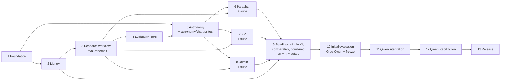

# Implementation Plan — Jyotish Research Platform

> Status: DRAFT v0.4 (2026-11-18). Derived from plan §15 and §18.
> **Revision v0.4 (owner decisions at M1 start, 2026-11-18; see decisions.md "Owner decision log"):**
>
> - **D-030:** no Anthropic model in the product. Groq Qwen is the only runtime provider (ID recorded in D-012). The Anthropic adapter and T6.0 are dropped; the Groq adapter moves from M8 to M6. The separate "Stage A (Opus) baseline" disappears: M7 evaluates the Qwen runtime. The judge model is open (Q-018). *(Update, second owner message 2026-11-18: owner proposed the same Groq model as judge, so all runs are self-judged; Q-019 partly answered, Preview accepted for the initial experimental runtime; Groq ZDR UNCONFIRMED; no real model call before the security.md §4 gate is approved.)*
> - Q-006 answered (no default Jaimini profile). Q-017 answered (Chara Dasha needs a source-approved specification **and** an independent calculation check). Q-012 provisionally accepted, still PROPOSED. Q-014 still open: T2.1 is split. Q-013: calibration gates only the "calibrated Hindi results" claim.
> - New open questions: Q-018 (judge model), Q-019 (Preview model risk).
> - Task checkboxes below were ticked only where the work was actually done and checked; M1 status is recorded in §3.
> **Revision v0.3 (post-review corrections):**
>
> - Model naming: "configured Anthropic Opus model", ID verification task T6.0 / Q-016, M1 not blocked.
> - Verification responsibilities (testing.md §7).
> - M5c gates, including UI availability.
> - Progressive testing timing (M2–M7).
> - Q-012 sampling rule.
> - Plan-phase column corrected.
> **Revision v0.2 (architecture review):** all reading types move before the initial Opus evaluation (D-023, now ACCEPTED); evaluation is built progressively from the research milestone (D-028); Track D / Track I separation (D-022); Hindi suites (D-029); payload minimisation (D-027); separate Lahiri/KP and 7k/8k profiles (D-003, D-007); K.N. Rao Chara Dasha specified from the exact publication (D-008); configurable node and Vimshottari year length (D-004, D-025).
> Related: [prd.md](prd.md), [architecture.md](architecture.md), [testing.md](testing.md), [decisions.md](decisions.md).

## 1. Global definition of done

A task is **done** only when all of the following hold:

1. Code is merged on `main` via a reviewed branch, and CI is green (lint, types, unit, integration, import-linter contracts, Track D suites available at that milestone).
2. Every implemented rule has a rule record (ID, source citation, status) and tests referencing that rule ID.
3. Every calculation has unit tests, including boundary cases, **and its golden cases exist in the relevant evaluation suite** (D-028). Every offered convention option (e.g. `MEAN`/`TRUE` node, each `dasha_year_days` value, 7k/8k) is tested.
4. New conventions or tradeoffs are recorded in [decisions.md](decisions.md). Unresolved questions are added to its Open questions list, not answered by assumption.
5. Docs touched by the change are updated (API, data model, UI). User-facing strings exist in both `en` and `hi`.
6. No secrets, books, or birth data of real people are committed. Provider payloads pass the minimisation tests (D-027).

## 2. Phase order (D-023, ACCEPTED)

All reading types are implemented **before** the first full evaluation (with the Groq Qwen runtime, D-030; originally written as the "configured Anthropic Opus model"): individual Parashari, KP, and Jaimini readings, comparative readings, and optional combined readings, in English and Hindi. Stages A/B/C from plan §11 are unchanged.

"Plan §15 phase" refers to the numbered rows of the phase table in plan §15 (it has no sub-sections).

| # | Milestone | Phase | Plan §15 phase | Stage | Main deliverable | Evaluation increment (D-028; testing.md §6.5) |
|---|---|---|---|---|---|---|
| 1 | M1 | Project foundation | 1 | A | Working repo, CI, conventions, licensing notes | CI slot for Track D |
| 2 | M2 | Source library | 2 | A | Searchable library | Source catalogue checks, citation existence, passage review workflow |
| 3 | M2 | Research workflow | 3 | A | Traceable rule workflow | Case/rule schemas, `source-fidelity` checks in CI, PROVISIONAL cases with rules |
| 4 | M3 | Evaluation core | 4 | A | Runner, reports, versioning | Rule-record and source-attribution checks expand; comparators, reports, freeze, run metadata |
| 5 | M4 | Shared astronomy | 5 | A | Tested astronomical foundation | First calculation-engine suites in CI: `astronomy`, `chart` |
| 6 | M5a | Parashari engine | 6 | A | Parashari module | `parashari` suite |
| 7 | M5b | KP engine | 7 | A | KP module | `kp` suite |
| 8 | M5c | Jaimini engine | 8 | A | Jaimini module (7k + 8k; Chara Dasha only if D-008 gates pass) | `jaimini` suite |
| 9 | M6 | Readings: single ×3, comparative, combined (en + hi) | 12 (moved earlier, D-023) | A | Readings with validator and payload minimiser; Groq Qwen as runtime (D-030) | Track I tier 1 checks in CI; `reading-*`, `comparison-*`, `adversarial-*` (en + hi); judge harness |
| 10 | M7 | Initial evaluation with the Groq Qwen runtime & dataset freeze (judge per Q-018) | 9 | A | Initial validation report, frozen dataset v1.0.0 | First deliberate full Track D + I run, baselines |
| 11 | M8 | Qwen integration (adapter work moved into M6, D-030) | 10 | B | Qwen prompts tuned, model-change procedure | — |
| 12 | M8 | Qwen stabilization | 11 | B | Stable Qwen baseline | Re-runs vs frozen dataset after prompt/model changes |
| 13 | M9 | Application polish & release | 13 | C | Release candidate (local) | Release regression run |

Phases 2–4 overlap; evaluation work starts in Phase 3, not after it. Phases 6, 7, and 8 can run in parallel once Phase 5 is done.

## 3. Milestones and tasks

### M1: Foundation (Phase 1)

Depends on: none.

**M1 status (2026-11-18): technically complete except T1.2's private remote and the GitHub run of CI, which need the owner.** Evidence for each tick is in the M1 report in the session summary; commands are in CLAUDE.md "Commands".

- [x] T1.1 Confirm OS/hardware (Windows 11 observed), Docker Desktop + WSL2, Git, Python 3.12, Node LTS (D-014, D-019). Observations recorded in D-014 History (Docker Desktop was off and had to be started; RAM 15.8 GB).
- [ ] T1.2 `git init`, `.gitignore` (library files, `.env`, data volumes), `.gitattributes` (LF line endings), private remote (D-024). **Done:** `git init -b main`, `.gitignore`, `.gitattributes`, pre-commit checks (no `.env` or secrets, no personal data, no books, file list reviewed), and the initial local commit. **Not done:** the private remote, the push, and the GitHub CI run. The GitHub CLI is not authenticated on this machine, so the repository cannot be created from here. Exact steps are in [deployment.md](deployment.md) §9. The remote must be confirmed PRIVATE before pushing.
- [x] T1.3 Scaffold repo per plan §14 (flat `docs/` as in this folder).
- [x] T1.4 `pyproject.toml` (uv), ruff, mypy, pytest, Hypothesis; `apps/web` Next.js + TS strict + ESLint + Vitest + Playwright + next-intl. (Alembic is not part of T1.4; it arrives with the data model in M2.)
- [x] T1.5 `docker-compose.yml`: `db` (Postgres 17 + pgvector), `api`, `web`, localhost bindings only. Verified live: all three containers healthy; ports 3000/8000 bound to 127.0.0.1; DB port not published.
- [x] T1.6 import-linter contracts for tradition isolation (D-021). Five contracts kept; a canary violation (cross-tradition import and a database import in `engine/`) was confirmed to break three of them, then removed.
- [x] T1.7 CI pipeline (see [deployment.md](deployment.md) §3) with an empty Track D stage. **Written and every step run locally; not yet run on GitHub** (no remote).
- [x] T1.8 Licensing memo: Swiss Ephemeris AGPL vs professional licence; GeoNames CC-BY; book copyright procedure (D-011, D-013). See [licensing.md](licensing.md). It records what was and was not verified.
- [x] T1.9 Owner reviews PROPOSED decisions and Open questions. **Done for the items the owner addressed on 2026-11-18** (decisions.md "Owner decision log"); D-003–D-010, D-025 stay PROPOSED; every other question stays open and blocks only the modules that depend on it.

**Exit:** `docker compose up` shows a health page: **met**, run locally (API `/api/v1/health` returns `ok` with the database check reaching Postgres; web health page renders in English and Hindi; 3 Playwright + axe checks pass). CI is green on an empty test suite with the contracts in place: **met locally**; the GitHub run is pending the remote.

**Evaluation increment delivered in M1 (D-028):** the Track D CI slot (`pytest -m track_d`), the `evaluation/` and `knowledge/rules/` layout, a guard that no golden case or rule record exists before the M2 schema, and a guard that no model ID is hard-coded anywhere in code or config.

### M2: Library & research workflow (Phases 2–3)

Depends on: M1.

**M2 status (2026-11-18): IN PROGRESS, not complete.** Built so far (all tested, no provider call, no book ingested): the rule knowledge base schema, validator, lifecycle with owner approval, append-only history check, runtime retrieval gate, source-catalogue schema, the `jyotish rules` command, and the evaluation policy helpers (SELF_JUDGED labelling, Q-012 sampling). Reference: [rule-schema.md](rule-schema.md), decision D-031. **Remaining for the M2 exit:** T2.1b (needs the owner's inventory), T2.2–T2.5 (ingestion, page review, search, glossary), T2.7 (workflow docs), the golden-case schema and validator, the rule-to-DB loader, and the owner approval screen. The M2 exit check ("owner can upload a book, review pages, search it, and see a drafted rule with a citation and a PROVISIONAL golden case") **has not been met**.

- [ ] T2.1 **Split (owner decision on Q-014, 2026-11-18): the owner has not confirmed owning any recommended book; the inventory is UNCONFIRMED.**
  - [ ] T2.1a *Not blocked* (**partly done:** source-catalogue schema, template and validator are built; the copyright checklist and ingestion/OCR/search infrastructure are not): build the source catalogue schema, the empty inventory template (`knowledge/source_catalog/`), the copyright-check procedure as a checklist, and ingestion/OCR/search infrastructure tested on **synthetic or public-domain test documents only**. No named book is assumed.
  - [ ] T2.1b *Blocked until the owner supplies the inventory (Q-014):* for each owned source, record editions, formats, ISBN, rights (Q-015) and ingest it. Any task that needs a specific book (e.g. K.N. Rao edition, Q-008) waits.
- [ ] T2.2 Ingestion: checksum, catalogue entry, embedded-text extraction, Tesseract OCR (eng/hin/san), page mapping.
- [ ] T2.3 Page reviewer UI + API (S9).
- [ ] T2.4 Passage chunking, FTS, embeddings (local model, D-017), hybrid search.
- [ ] T2.5 Glossary seed (≈200 core terms, IAST + Devanagari + en/hi); Hindi gloss reviewed by owner.
- [ ] T2.6 Rule YAML schema + validator CLI (`jyotish rules validate`) + loader to DB. **Done:** schema (three rule kinds, four namespaces, versions, lifecycle), validator with 105 distinct finding codes, CLI (`validate`, `list`, `hash`, `seal`, `approve`), runtime retrieval gate, CI step. **Not done:** the loader that indexes rules into PostgreSQL (needs the data model migration, T2.4).
- [ ] T2.7 Research workflow docs/skills for Claude Code: "extract candidate rule", "draft golden case", "record conflict", "record open question".
- [ ] **T2.8 Evaluation increment (D-028), first Track D checks in CI (before M4):**
  - Source-catalogue checks (metadata, checksum, rights recorded). **Done** (schema and validator; the real catalogue is empty, Q-014).
  - Citation existence. **Done at source level** (every cited source must be catalogued); passage-level existence waits for ingestion (T2.2/T2.4).
  - `source-fidelity` checks (SUPPORTS relation, passage review status). **Done at rule-record level** (a VERIFIED rule needs a reviewed SUPPORTS passage covered by the owner's approval); cross-check against the passage index waits for T2.4.
  - Rule-record checks run in CI as a Track D stage (`tests/track_d/test_rulebase.py`) and as `jyotish rules validate --strict` with the append-only history comparison. **Done.**
  - Passage review workflow status checks.
  - Golden-case YAML schema (incl. `drafted_by`, `reviewed_by`, `independent_validation`, `language`, `-HI` twin link) and case validator.
  - Every drafted rule gets at least one PROVISIONAL golden case.
- [ ] T2.9 **(rule review records and the owner approval action done as the CLI `jyotish rules approve`; the UI screen is not built)** Rule review records (`rule_review` with `actor`, `review_type`) and the owner "Approve source & evidence" action. Owner approval is recorded as SOURCE_APPROVAL, not as expert validation (testing.md §7).

**Exit:** owner can upload a book, review pages, search it, and see a drafted rule with a citation and a PROVISIONAL golden case. Source-fidelity and citation checks run in CI.

### M3: Evaluation core (Phase 4)

Depends on: M1. Starts during M2 and continues alongside later milestones.

- [ ] T3.1 Dataset versioning and freeze (content hash, CI check that frozen files are unchanged).
- [ ] T3.2 Track D runner: numeric comparators with tolerances; categorical comparators; date comparators; rule assertions.
- [ ] T3.3 Report generator: per suite, per tradition, per language, per track/tier; diff vs baseline; individual failures.
- [ ] T3.4 Run metadata capture (plan §12; data-model §6.3): runtime and judge configuration stored separately, dataset content hash, rubric versions, self-judged flag, spot-check sample record; runs immutable once finished; `run_decision` and `spot_check_review` as append-only records.
- [ ] T3.5 Track I scaffolding: case format for rubric criteria and prohibited claims; result schema with per-tier outcomes (no LLM yet).
- [ ] T3.6 **Evaluation increment:** rule-record and source-attribution checks expand as the knowledge base grows (every rule's citations resolve, tradition prefix matches, alternatives/conflicts linked, `independent_validation` never set without a matching review), in CI.

**Exit:** a sample dataset (≥ 5 astronomy cases) runs through Track D and produces a report.

### M4: Shared astronomy (Phase 5)

Depends on: M1, M3.

- [ ] T4.1 Time normalization: zoneinfo, ambiguous/nonexistent handling, manual override, LMT, pre-1955 India warnings (D-016).
- [ ] T4.2 GeoNames offline import + `/places` search (D-015).
- [ ] T4.3 Ephemeris wrapper: positions, speeds, retrograde, **`MEAN` and `TRUE` node**, ayanamsha values, Placidus/whole-sign/Sripati cusps.
- [ ] T4.4 Calculation profiles: separate `parashari-lahiri`, `kp-krishnamurti`, `jaimini-lahiri-7k`, `jaimini-lahiri-8k` (D-003, D-007); profile validator rejects missing settings; profile-separation tests.
- [ ] T4.5 Shared derivations: sign, degree, nakshatra, pada, varga arithmetic.
- [ ] T4.6 Exact-arithmetic boundary utilities + boundary warnings + sensitivity pass (D-006, D-010).
- [ ] T4.7 Independent reference harness: Skyfield/JPL comparison over sampled dates 1800–2399; Lahiri and KP ayanamsha checks against reference values (Q-001, Q-002).
- [ ] T4.8 **Evaluation increment:** first calculation-engine Track D suites, `astronomy` + `chart` (≥ 50 cases incl. edge cases from testing.md §4; node cases under both settings), in CI.
- [ ] T4.9 Birth record + chart API and S2/S3 UI.

**Exit:** astronomy suite passes ≤ 1″ vs reference, and all shared-chart VERIFIED cases pass.

### M5: Tradition engines (Phases 6–8, parallel)

Depends on: M4, M2 (rules).

**Parashari (M5a)**, profile `parashari-lahiri`:

- [ ] Lordships, dignity, graha drishti → yogas (start with ~20 well-attested yogas) → vargas tranche 1 → Vimshottari (3 levels) with **configurable `dasha_year_days`** (365.25 initial, D-025; tests for each supported value) → Shadbala (conventions documented).

**KP (M5b)**, profile `kp-krishnamurti` (KP-specific ayanamsha, **Placidus** cusps):

- [ ] Star/sub/sub-sub lords (249-sub table generated and compared with the KP reference table, Q-005) → Placidus cusps + cuspal sub-lords → significators (4-level) → ruling planets.

**Jaimini (M5c)**, profiles `jaimini-lahiri-7k` and `jaimini-lahiri-8k`:

- [ ] Chara Karakas under **both** schemes as separate profiles (8k: Rahu 30° − degree; ties per rule records). The karaka scheme is not tied to the dasha method (Q-007). **No default profile (owner decision on Q-006): the user always selects 7k or 8k; nothing is preselected.** Karaka, Rashi Drishti, Argala, and Karakamsha work proceeds under its own rule-record verification gates and does not wait for Chara Dasha.
- [ ] Rashi Drishti → Argala/Virodhargala → Karakamsha.
- [ ] **Chara Dasha (K.N. Rao), D-008 rev. 3.** Roles per testing.md §7.
  - [ ] Owner provides exact edition details (Q-008); Claude Code catalogues the source.
  - [ ] Claude Code drafts one PROVISIONAL rule record per calculation step (D-008 steps 1–8) citing chapter/page of that edition (Q-009). It reports ambiguities and conflicts instead of resolving them, and fills nothing from other variants or general knowledge.
  - [ ] Owner reviews each step's cited passage and evidence and records SOURCE_APPROVAL. This makes the step rule VERIFIED (source-approved). It is not independent expert validation.
  - [ ] Any independent review or independent calculation is recorded only if one actually exists; none is assumed.
  - [ ] **Implementation gate:** no Chara Dasha code until all eight step rules cite the exact edition and are VERIFIED. Owner approval of documentation alone does not open it.
  - [ ] Implement `CHARA_KNRAO_<edition>`. Automated tests reproduce every worked example in the book as golden cases; this shows the code matches the book, not that the method is validated.
  - [ ] Cross-check with one independent implementation (name/version/settings recorded).
  - [ ] **Availability gate (UI/API):** until the implementation exists and every D-008 *Verification required* item is complete, the UI shows Chara Dasha as "under research" and the API returns `METHOD_NOT_AVAILABLE`. If no independent implementation or reviewer can be found, the gate stays closed. **Owner answer to Q-017 (2026-11-18):** Chara Dasha stays unavailable in the initial release unless it has both a source-approved specification and an independent calculation check. No weaker evidence opens the gate.

For each engine:

- [ ] Rule records with citations for every implemented rule.
- [ ] Unit + boundary + property tests.
- [ ] **Evaluation increment:** golden collection ≥ 30 cases in the tradition's Track D suite, added feature by feature, in CI.
- [ ] API endpoints + UI tabs (S4/S5/S6).

**Exit per engine:** all VERIFIED cases pass, and no import-linter violations. If the Chara Dasha research gates are not yet passed, M5c exits without Chara Dasha: the gap is recorded and the feature stays "under research" in the UI. Jaimini readings in M6 then use karakas, Rashi Drishti, Argala, and Karakamsha only.

### M6: Readings (Phase 9): all reading types before the initial evaluation

Depends on: M5 (all three), M2.

- [x] ~~T6.0 Verify the Anthropic model ID~~ **Dropped (D-030; Q-016 withdrawn).** The Groq ID `qwen/qwen3.8-27b` was checked against Groq's official catalogue on 2026-11-18 and recorded in D-012. Before the first real call: confirm it is still listed (it is a Preview model, Q-019) and record whether Zero Data Retention is enabled.
- [ ] T6.1 Provider adapter interface + **Groq implementation** + fake provider (model ID from config only; no Anthropic adapter). Includes the structured-output check (JSON Schema Mode) that was T8.2.
- [ ] T6.2 Structured output schema (claims), validator, single repair attempt.
- [ ] T6.3 **Payload minimiser (D-027):** categorical facts, rounded degrees, boundary flags, windowed dasha dates, no identifiers; snapshot tests; UI notice that question text is sent.
- [ ] T6.4 Retrieval: rules triggered by facts + passages (tradition-filtered).
- [ ] T6.5 Prompts v1, each in en + hi:
  - [ ] Individual Parashari reading
  - [ ] Individual KP reading
  - [ ] Individual Jaimini reading
  - [ ] Comparative reading
  - [ ] Optional combined reading (attribution per point, children retained)
- [ ] T6.6 Reading API + S7 UI with drill-down.
- [ ] T6.7 **Evaluation increment (Track I):** suites `reading-en/hi`, `comparison-en/hi`, `adversarial-en/hi` (D-029); tier 1 automatic checks running in CI with the fake provider; judge harness for deliberate runs with separately configured judge provider/model ID (chosen under Q-018), versioned rubric and judge prompt (D-022); Hindi calibration set for owner ratings (Q-013). Hindi prompts, UI, and `*-hi` cases are built now; only the claim of *calibrated* Hindi evaluation waits for Q-013.

**Exit:** all five reading types work in en and hi; readings validate; payload tests pass; no invented citations in a 20-reading smoke set per language.

### M7: Initial evaluation with the Groq Qwen runtime & freeze (Phase 10)

Depends on: M6, a runtime model ID that is still listed by Groq (D-012, Q-019), and the owner's approval of the first-real-call gate ([security.md](security.md) §4: provider configuration, ZDR status or written risk acceptance, cost). The judge is the same model as the runtime (Q-018), so every run is self-judged.

- [ ] T7.1 Review of architecture, rules, and golden cases by a model in its research/review role, only if the owner wants one (Claude Code is the drafting tool; a separate model review is optional). Each review is recorded as DRAFT_REVIEW with provider and exact model ID where one applies (`reviewed_by`, `rule_review`).
- [ ] T7.2 Owner reviews cited passages, evidence, and unresolved conflicts for disputed and important cases (plan §10.3 step 5), and records SOURCE_APPROVAL where appropriate. **Cases drafted by any model are not VERIFIED without owner approval and independent evidence** (D-022, D-030). Independent review or calculation is recorded only where it actually exists. The owner is not asked to supply specialist Jyotish validation (testing.md §7).
- [ ] T7.3 Confirm acceptance thresholds ([testing.md](testing.md) §6.6) and the spot-check sampling rule (§6.4; Q-012 is provisionally accepted but stays PROPOSED until the owner explicitly approves its final status).
- [ ] T7.4 Hindi judge calibration run; record agreement (Q-013). Until done, Hindi tier 2 results are labelled "uncalibrated" and are not described as calibrated.
- [ ] T7.5 Freeze dataset v1.0.0.
- [ ] T7.6 Full run: Track D + Track I with the Qwen runtime and the judge chosen under Q-018 (if the judge is the same model the run is marked *self-judged*, 25% sample rate) → owner spot-checks per the sampling rule (all failures; 10% of eligible passes, or 25% when self-judged, min. 5 when ≥ 5 exist, otherwise all; never more than exist; sample record stored) → fix defects → rerun until thresholds pass. No run starts without the owner's explicit cost go-ahead.
- [ ] T7.7 One comparison run of minimised vs fuller payload to confirm D-027 does not degrade quality (Q-011).
- [ ] T7.8 Initial validation report; store the first baseline (runtime and judge model IDs recorded separately; label results provisional wherever they rest on a PROPOSED convention, D-003–D-010, D-025).

**Exit:** the first baseline meets all category thresholds, per language, on frozen v1.0.0.

### M8: Qwen stabilization & model-change procedure (Phases 11–12)

Depends on: M7.

- [x] ~~T8.1 Verify the Groq model ID, availability, and data-retention policy (D-012)~~ Done 2026-11-18 (recorded in D-012). **Repeat the availability check** before every deliberate run and whenever Groq's deprecations page changes (Preview model, Q-019).
- [x] ~~T8.2 Groq adapter; structured-output check~~ Moved to T6.1 (D-030).
- [ ] T8.3 Tune prompts against the frozen benchmark (Track D + I, en + hi), each attempt recorded as a new run, then rerun.
- [ ] T8.4 Write the **model-change procedure** (what to do when Groq retires or replaces the model: new register entry, re-run the frozen dataset, compare with the stored baseline, owner approval of the migration, rollback per deployment.md §7). Record the production baseline (model + prompts + config).

**Exit:** the Qwen runtime meets thresholds in both languages and the model-change procedure is recorded.

### M9: Release (Phase 13, Stage C)

Depends on: M8.

- [ ] T9.1 Hindi UI review pass; accessibility audit (axe + manual keyboard pass).
- [ ] T9.2 Security checklist ([security.md](security.md) §8).
- [ ] T9.3 Backup/restore tested end-to-end.
- [ ] T9.4 Owner guide (how to run, back up, run an evaluation, migrate a model).
- [ ] T9.5 Tag `v1.0.0`.

**Exit:** release candidate runs from a clean machine using the deployment guide.

## 4. Immediate next steps (from plan §18)

1. ~~Confirm OS~~ (Windows 11 observed). Confirm Claude Code + Docker Desktop installed.
2. Owner provides the book inventory against the D-011 list, including the exact edition of K.N. Rao's Chara Dasha book (T2.1b, Q-008, Q-014). **Still outstanding;** M2 infrastructure (T2.1a) does not wait for it.
3. ~~Owner reviews PROPOSED decisions and Open questions (T1.9)~~ Done 2026-11-18 for the items the owner addressed; the rest remain open (decisions.md "Current status of every question").
4. ~~Start M1~~ Started 2026-11-18. M1 status is in §3 (M1 task list). Open: Q-018 (judge model) and Q-019 (Preview model) block only M6/M7 model-dependent work.
