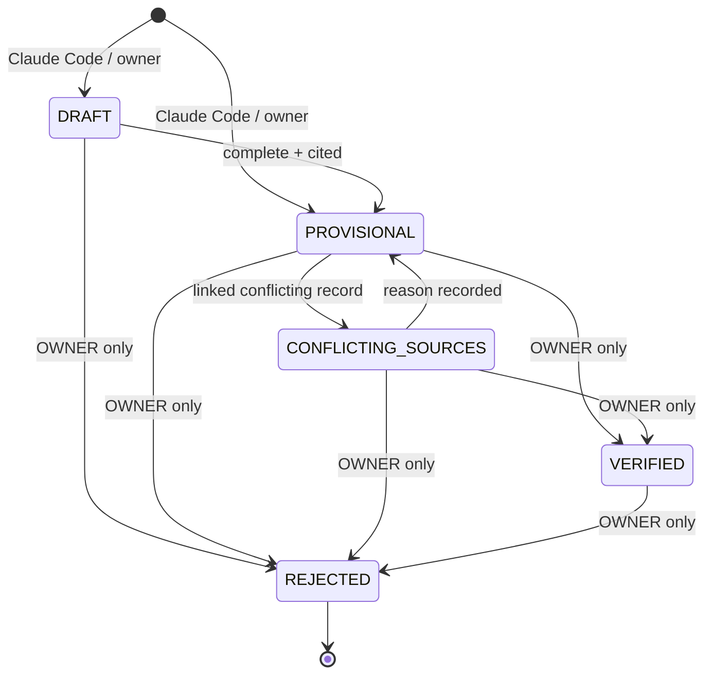

# Rule Knowledge Base — Schema, Lifecycle and Validator

> Status: DRAFT v0.1 (2026-11-18), milestone M2, task T2.6 (+ T2.9 approval records, parts of T2.1a and T2.8). Design decision: [decisions.md](decisions.md) D-031 (PROPOSED). Data model summary: [data-model.md](data-model.md) §4.4. Tests: [testing.md](testing.md) §6.5.
> **The knowledge base is empty by design.** No rule record exists, because the owner has not confirmed owning any source book (Q-014) and no rule may be written without a source. Every example in this file is **SYNTHETIC**: it exercises the format and says nothing about Jyotish.

## 1. What this gives you

- One YAML file per rule, in a **separate namespace per tradition**, plus a **shared** namespace for tradition-neutral mechanics.
- Three **kinds** of record that are never mixed: calculation rules, calculation conventions, interpretive rules.
- A **lifecycle** in which only the owner can make a rule VERIFIED, and that approval is bound to the exact text approved.
- **Version history and audit records** that can only be appended to.
- A **runtime retrieval gate**: unapproved research drafts cannot reach the interpretation layer.
- A validator (`jyotish rules validate`) that checks all of this in CI.

What it does **not** do: prove a rule is correct Jyotish; prove who typed an approval (see §7); read books. No book is ingested, no provider is called.

## 2. Layout and namespaces

```text
knowledge/
  rules/
    _vocabulary.yaml        controlled topic list (3-letter codes used in rule IDs)
    parashari/  PAR-ASP-0001.yaml ...
    kp/         KP-SUB-0001.yaml ...
    jaimini/    JAI-KRK-0001.yaml ...
    shared/     SHR-NAK-0001.yaml ...
  source_catalog/
    SRC-<ID>.yaml           one per source the owner has confirmed (empty today)
```

| Namespace | Prefix | Directory | Holds |
|---|---|---|---|
| `PARASHARI` | `PAR` | `parashari/` | Parashari rules and conventions |
| `KP` | `KP` | `kp/` | KP rules and conventions |
| `JAIMINI` | `JAI` | `jaimini/` | Jaimini rules and conventions |
| `SHARED` | `SHR` | `shared/` | Tradition-neutral mechanics (e.g. nakshatra arithmetic). Never tradition-specific content |

Rule ID: `(PAR|KP|JAI|SHR)-<TOPIC CODE>-<4 digits>`. The prefix must match the namespace and directory; the topic code must be the code of the rule's `topic` in `_vocabulary.yaml`, and that topic must be allowed in the namespace. The file name is `<RULE_ID>.yaml`.

**Isolation rules (CLAUDE.md rule 2), enforced by the validator:**

- `DEPENDS_ON` (and the typed links in §4) may point only to the rule's own namespace or to `SHARED`. `SHARED` rules depend only on `SHARED`. Another tradition's rule is never borrowed.
- *Conflicts across traditions are allowed and kept:* `CONFLICTS_WITH` / `ALTERNATIVE_READING` may link a Parashari record to a KP record. They stay two records.

## 3. Record structure (annotated, SYNTHETIC)

```yaml
schema_version: 1
rule_id: PAR-ASP-0001
namespace: PARASHARI
rule_type: INTERPRETIVE_RULE         # CALCULATION_RULE | CALCULATION_CONVENTION | INTERPRETIVE_RULE
topic: aspect                        # from _vocabulary.yaml; code ASP must match the rule_id
terms: [synthetic_term]              # glossary keys (lower_snake_case)
independent_validation: NONE         # NONE unless an approving independent review exists (derived, never assumed)
versions:                            # APPEND-ONLY. Content of a recorded version is immutable
- version: 1
  created: 2026-11-10
  created_by: {actor: CLAUDE_CODE}   # CLAUDE_CODE | OWNER | MODEL (needs provider + exact model_id)
  change_note: Initial draft
  content:                           # fields depend on rule_type (section 4)
    title: "EXAMPLE ONLY: a synthetic interpretive rule"
    statement: SYNTHETIC EXAMPLE for documentation. Not a Jyotish claim.
    citations:
    - citation_id: SRC-TEST-A:ch1:v1 # <source_id>:<locator>; source must be in the catalogue
      relation: SUPPORTS             # SUPPORTS | CONTRADICTS | COMMENTARY
      quote: Synthetic quote used only in tests.   # short (<= 500 characters)
      chapter: '1'
      page: '10'                     # page as printed in the cited edition
      passage_review_status: REVIEWED  # UNREVIEWED | REVIEWED | CORRECTED
    conditions: [{text: Synthetic condition}]
    effect: Synthetic effect
    relations: []                    # see section 5
    ambiguity_notes:                 # Claude Code reports ambiguities here instead of resolving them
    - "Synthetic: the example source is silent about exceptions."
  content_hash: sha256:e9ac...399c   # binds reviews to this exact text; written by `jyotish rules seal`
reviews:                             # APPEND-ONLY audit of every review
- review_id: R-0001
  rule_version: 1
  content_hash: sha256:e9ac...399c   # the version it reviewed: approval is version-bound
  actor: OWNER                       # OWNER | CLAUDE_CODE | MODEL | INDEPENDENT_REVIEWER
  review_type: SOURCE_APPROVAL       # + DRAFT_REVIEW, TECHNICAL_VALIDATION, INDEPENDENT_REVIEW, INDEPENDENT_CALCULATION
  verdict: APPROVE                   # APPROVE | REQUEST_CHANGES | CONFLICT_NOTED | REJECT
  date: 2026-11-12
  recorded_via: CLI_INTERACTIVE      # owner reviews must come from `jyotish rules approve`
  evidence: {citation_ids: [SRC-TEST-A:ch1:v1]}
lifecycle:                           # APPEND-ONLY status events, per version
- {event_id: E-0001, rule_version: 1, from: null, to: PROVISIONAL, date: 2026-11-11, actor: CLAUDE_CODE}
- {event_id: E-0002, rule_version: 1, from: PROVISIONAL, to: VERIFIED, date: 2026-11-12,
   actor: OWNER, recorded_via: CLI_INTERACTIVE, review_id: R-0001}
```

Reviews by non-owners carry the evidence their type needs: `TECHNICAL_VALIDATION` lists `evidence.tests`; `INDEPENDENT_REVIEW` records `reviewer_name` and `stated_qualifications` exactly as stated; `INDEPENDENT_CALCULATION` records `evidence.independent_source` (`name`, `version`, `settings`); a `MODEL` review records `provider` and the exact `model_id`. **Claude Code and models can never be recorded as independent reviewers** (the validator rejects model-like names).

## 4. Three kinds of record

| | `CALCULATION_RULE` | `CALCULATION_CONVENTION` | `INTERPRETIVE_RULE` |
|---|---|---|---|
| Answers | *How* is it computed? | *Which setting* does a profile use? | *What does it signify?* |
| Own fields | `formal_spec`, `inputs`, `outputs`, `uses_conventions`, `method_id` | `convention`: `setting_key`, `applies_to_profiles`, `chosen_value`, `alternatives`, `decision_ref` | `conditions`, `effect`, `exceptions`, `requires_calculation_rules`, `interpretation_notes` |
| Common fields | `title`, `statement`, `citations`, `relations`, `ambiguity_notes` | same | same |
| Reaches the AI layer | No (engine-side) | No (engine-side) | **Yes**, only when VERIFIED |

Content models forbid unknown keys, so a calculation field in an interpretive rule (or the reverse) is an error (`CONTENT-SCHEMA`).

**Typed links:** a calculation rule's `uses_conventions` must name `CALCULATION_CONVENTION` records; an interpretive rule's `requires_calculation_rules` must name `CALCULATION_RULE` records (`TYPE-LINK`).

**Conventions (CLAUDE.md rule 4):**

- `setting_key` is one of `ayanamsha`, `node`, `house_system`, `karaka_scheme`, `jaimini_dasha_method`, `dasha_year_days`, `boundary_rule`, `varga_method`.
- `applies_to_profiles` uses profile keys (`parashari-lahiri`, `kp-krishnamurti`, `jaimini-lahiri-7k`, `jaimini-lahiri-8k`). A tradition's convention can name only that tradition's profiles; profiles stay separate objects.
- `dasha_year_days` can never apply to Jaimini (Vimshottari only). `karaka_scheme` and `jaimini_dasha_method` are Jaimini-only and **independent**: one convention may not depend on the other (`CONV-COUPLING`); a calculation rule using both gets a warning (`CONV-COUPLING-CALC`) because Q-007 is open.
- `decision_ref` (e.g. `D-003`) must exist in [decisions.md](decisions.md). **A convention cannot be VERIFIED while its decision is not ACCEPTED** (a heading that is PROPOSED, OPEN, or mixed counts as not accepted). Today D-003 to D-010 and D-025 are PROPOSED, so no convention for them can be VERIFIED; they can be drafted and stay PROVISIONAL.

**Chara Dasha (D-008):** a calculation rule with `method_id: CHARA_KNRAO_<edition-key>` must be in the JAIMINI namespace and may cite only sources that record edition, publisher and year. This does not open the availability gate, which still needs a source-approved specification **and** an independent calculation check (Q-017).

## 5. Relations and conflicts

`relations: [{kind, target, note}]` inside a version's content:

| Kind | Meaning | Rules |
|---|---|---|
| `DEPENDS_ON` | needs another rule | own namespace or `SHARED` only; no cycles; a VERIFIED rule may depend only on rules that themselves have a VERIFIED version |
| `CONFLICTS_WITH` | sources or traditions disagree | needs a `note` (≥ 10 characters); the other record must link back with the **same kind** (`REL-ASYMMETRIC`); cross-tradition allowed |
| `ALTERNATIVE_READING` | another reading of the same source question | same as above |
| `SUPERSEDES` | replaces a rule the owner has REJECTED | same namespace; target must be REJECTED; needs a `note` |

**Conflicts are never merged.** A `CONTRADICTS` citation is an error unless the record that reflects the contradicting source exists and is linked (`CONFLICT-NOT-PRESERVED`). A rule can enter `CONFLICTING_SOURCES` only with such a link.

## 6. Lifecycle

Status belongs to a **version**. A version's status is the `to` of its last lifecycle event. A new version always starts again at DRAFT or PROVISIONAL.



| Status | Meaning | Completeness required | Served to the AI layer |
|---|---|---|---|
| `DRAFT` | working notes | none | no |
| `PROVISIONAL` | complete, cited, awaiting owner source approval | title, statement, ≥ 1 SUPPORTS citation with quote and page/chapter, type-specific fields | no |
| `CONFLICTING_SOURCES` | sources disagree; kept as linked records | as PROVISIONAL + conflict relation | no |
| `VERIFIED` | **owner source-approved** against the cited passages. **Not** expert validation | as PROVISIONAL + the preconditions below | **yes** |
| `REJECTED` | owner rejected this version | n/a | no |

**Preconditions of VERIFIED** (all checked): an `OWNER` / `SOURCE_APPROVAL` / `APPROVE` review for *this version's exact content hash*, recorded through the interactive CLI, dated no later than the event; the review's `evidence.citation_ids` covers at least one SUPPORTS citation whose passage is REVIEWED or CORRECTED; every SUPPORTS source is owner-confirmed (or public domain) and has a recorded edition (Q-014: no book is assumed owned); for conventions, an ACCEPTED decision and a stated `chosen_value`.

**Approval resets with the text.** Editing content is impossible without a new version (hash check), and the new version needs its own approval. The previous VERIFIED version stays in the audit trail.

## 7. Approval, audit and what the system cannot prove

`jyotish rules approve <RULE_ID> --version N [--reject --reason "..."]`:

1. Refuses unless run in an **interactive terminal** (scripts, CI and AI agents cannot approve or reject).
2. Shows the statement, hash, every citation with its quote and passage status, relations and ambiguity notes, and states that this is *source approval, not expert validation*.
3. Requires the owner to **type the exact rule ID**.
4. Writes one `reviews` entry and one `lifecycle` event (`CLI_INTERACTIVE`), then re-validates; if the result would be invalid the file is **restored byte for byte** and nothing changes.

**Append-only history.** `jyotish rules validate --against <git-ref>` fails if anything recorded at that ref was changed or removed (`HIST-*`): versions, reviews and events may only be added, identity fields never change, and rule files are never deleted (a rule is rejected, not removed). CI runs it against the previous commit or the pull-request base.

**Honest limits (D-031, Q-020).** The validator checks that records are consistent. It cannot prove *who* typed an approval: a person with write access to the repository could still type a forged `CLI_INTERACTIVE` entry. The controls are the interactive-only command, the hash binding, the append-only history check against git, and the owner reviewing every diff that touches `reviews` or `lifecycle`. Cryptographic signing of owner approvals is an open question.

## 8. Runtime retrieval gate

`knowledge.rulebase.retrieval.load_runtime_rules(paths)` is the only door to the interpretation layer:

1. The whole rulebase must validate with zero errors; otherwise it raises `RulebaseInvalidError` and **nothing** is served.
2. Only the highest **VERIFIED** version of a rule is served, after a second, independent check for a version-bound owner approval recorded through the CLI.
3. DRAFT, PROVISIONAL, CONFLICTING_SOURCES and REJECTED are never served, even if a file claims otherwise. A newer unapproved version never takes an approved older version offline and is never served itself; a REJECTED newer version leaves the approved one in place (Q-021).
4. Output carries rule text and citation IDs only: no reviews, quotes, ambiguity notes or lifecycle.
5. Conflicting approved records are served as **separate rules** with explicit links. `for_single_tradition(ns)` returns that tradition plus `SHARED` and removes links that would name another tradition's rule.
6. The AI layer asks for `.interpretive()`; calculation rules and conventions are engine-side.

## 9. Commands

```text
uv run jyotish rules validate                       # exit 0 ok, 1 errors, 2 tool error
uv run jyotish rules validate --format json         # machine-readable
uv run jyotish rules validate --strict              # warnings fail too
uv run jyotish rules validate --against origin/main # + append-only history check
uv run jyotish rules list                           # status per rule, and whether retrieval would serve it
uv run jyotish rules hash PAR-ASP-0001              # print each version's content hash
uv run jyotish rules seal PAR-ASP-0001              # write missing content_hash (never overwrites a wrong one)
uv run jyotish rules approve PAR-ASP-0001 --version 1   # OWNER ONLY, interactive terminal
```

## 10. Working with records (Claude Code)

1. Write the record as `DRAFT` (or `PROVISIONAL` once complete and cited), `created_by: {actor: CLAUDE_CODE}`, with ambiguity notes. Never invent a citation, edition or page.
2. `jyotish rules seal <RULE_ID>` then `jyotish rules validate`.
3. Ask the owner to review the cited passage and run `jyotish rules approve`. **Never** write an `OWNER` review, a `VERIFIED` event or `independent_validation: RECORDED` by hand.
4. To change a recorded rule, **append** a new version (never edit an old one), seal, add its lifecycle events.
5. Disagreeing sources: write a second record and link both with `CONFLICTS_WITH` / `ALTERNATIVE_READING`.

## 11. Validator codes

| Group | Codes |
|---|---|
| Files | `FILE-YAML` (not valid or duplicate keys), `FILE-SCHEMA-VERSION`, `SCHEMA`, `CONTENT-SCHEMA`, `LOAD-NO-RULES-DIR`, `LOAD-UNKNOWN-NAMESPACE`, `LOAD-EXTENSION`, `LOAD-MISPLACED`, `LOAD-STRAY-DIR` |
| Identity | `RULE-ID-FORMAT`, `RULE-ID-NAMESPACE`, `RULE-DIR-NAMESPACE`, `RULE-FILENAME`, `RULE-DUPLICATE`, `TOPIC-UNKNOWN`, `TOPIC-CODE`, `TOPIC-NAMESPACE`, `TERM-FORMAT` |
| Versions | `VERSION-SEQUENCE`, `VERSION-HASH`, `VERSION-HASH-FORMAT`, `VERSION-CHANGE-NOTE`, `VERSION-ACTOR`, `VERSION-DATE-FUTURE`, `VERSION-DATE-ORDER`, `VERSION-NOOP` (warning) |
| Lifecycle | `EVENT-ID`, `EVENT-VERSION`, `EVENT-MISSING`, `EVENT-FROM`, `EVENT-TRANSITION`, `EVENT-ACTOR`, `EVENT-OWNER-ONLY`, `EVENT-APPROVAL`, `EVENT-REASON`, `EVENT-CONFLICT-RELATION`, `EVENT-DATE-ORDER`, `EVENT-DATE-FUTURE` |
| Reviews | `REVIEW-ID`, `REVIEW-VERSION`, `REVIEW-HASH`, `REVIEW-DATE`, `REVIEW-ACTOR-TYPE`, `REVIEW-OWNER-VIA`, `REVIEW-MODEL`, `REVIEW-INDEPENDENT`, `REVIEW-INDEPENDENT-NAME`, `REVIEW-EVIDENCE`, `IND-MISMATCH` |
| Citations and content | `CITATION-FORMAT`, `CITATION-DUPLICATE`, `CITATION-QUOTE-LONG`, `CITATION-SOURCE` (error once PROVISIONAL, warning for DRAFT), `CITATION-NO-SUPPORT`, `CITATION-QUOTE-MISSING`, `CITATION-LOCATOR`, `CONTENT-INCOMPLETE`, `CONFLICT-NOT-PRESERVED` |
| Relations | `REL-TARGET-FORMAT`, `REL-TARGET-UNKNOWN`, `REL-SELF`, `REL-DUPLICATE`, `REL-CROSS-TRADITION`, `REL-SUPERSEDES-NAMESPACE`, `REL-SUPERSEDES-TARGET`, `REL-NOTE`, `REL-ASYMMETRIC`, `TYPE-LINK`, `TYPE-LINK-UNKNOWN`, `DEP-CYCLE`, `DEP-UNVERIFIED` |
| Conventions and methods | `CONV-DECISION-FORMAT`, `CONV-DECISIONS-MISSING`, `CONV-DECISION-UNKNOWN`, `CONV-SETTING-SCOPE`, `CONV-PROFILE-UNKNOWN`, `CONV-PROFILE-NAMESPACE`, `CONV-COUPLING`, `CONV-COUPLING-CALC` (warning), `METHOD-ID`, `METHOD-NAMESPACE`, `CHARA-EDITION` |
| VERIFIED preconditions | `VERIFIED-PASSAGE-UNREVIEWED`, `VERIFIED-EVIDENCE`, `VERIFIED-SOURCE-OWNERSHIP`, `VERIFIED-SOURCE-EDITION`, `VERIFIED-DECISION-NOT-ACCEPTED`, `VERIFIED-NO-VALUE` |
| Sources | `SRC-ID`, `SRC-FILENAME`, `SRC-SCHEMA`, `SRC-SCHEMA-VERSION`, `SRC-DUPLICATE`, `SRC-SHA256`, `SRC-FILE-PATH`, `SRC-UNCONFIRMED-INGESTED` |
| Vocabulary | `VOCAB-MISSING`, `VOCAB-SCHEMA`, `VOCAB-CODE`, `VOCAB-NAMESPACES` |
| History (`--against`) | `HIST-DELETED`, `HIST-ENTRY-ALTERED`, `HIST-ENTRY-REMOVED`, `HIST-IDENTITY-CHANGED`, `HIST-BASELINE-UNREADABLE` (warning) |

Every code above has at least one negative test in `tests/unit/rulebase/` (a test fails if a new code is added without one).

## 12. Source catalogue records

`knowledge/source_catalog/<SOURCE_ID>.yaml`, template `_template.yaml.example`. Fields: `source_id`, `title`, `author`, `translator`, `commentator`, `edition`, `publisher`, `year`, `language`, `traditions`, `rights`, `rights_notes`, `ownership`, `extraction_method`, `sha256`, `file_path`. `ownership` is `UNCONFIRMED` until the owner confirms the copy; an UNCONFIRMED source cannot carry a checksum or file path, so nothing is ingested for it (Q-014). `file_path` must be an absolute path outside the repository.

## 13. Open design questions

- **Q-020:** how strongly must owner approvals be authenticated (for example signing with a key held by the owner)? Until answered, §7 describes the controls.
- **Q-021:** should retrieval keep serving the last approved version while a newer version is being drafted (current behaviour), or take the rule offline until the new version is approved?
